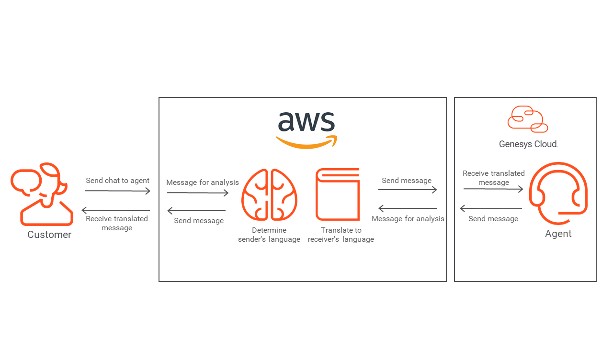

# [DEPRECATED] Build a chat translation assistant with the AWS Translate service

## Notice

Genesys deprecated web chats last June 11, 2025. See [article here](https://help.mypurecloud.com/announcements/deprecation-removal-of-acd-web-chat-version-2/). Genesys is investing in its next generation messaging platform, [Web messaging](https://developer.genesys.cloud/commdigital/digital/webmessaging/ "Goes to the Web messaging and Messenger page"). Please review the [Build a messaging translation assistant with the AWS Translate service](https://github.com/GenesysCloudBlueprints/digital-messaging-translator-blueprint "Goes to the Build a web messaging Chatbot calling an AWS Lambda via a Genesys Cloud Data Action") in Github or [here in Genesys Cloud Developer Center](https://developer.genesys.cloud/blueprints/digital-messaging-translator-blueprint/ "Goes to the Build a messaging translation assistant with the AWS Translate service") that delivers the same solution using Web Messaging.

> View the full [Genesys Cloud Chat Translator Blueprint article](https://developer.mypurecloud.com/blueprints/chat-translator-blueprint/) on the Genesys Cloud Developer Center.

This Genesys Cloud Developer Blueprint provides instructions for building a chat translation assistant which uses the AWS Translate service to allow customers and agents to chat in their preferred languages. The chat translation assistant automatically translates everything in the chat window in real-time, including canned responses.

